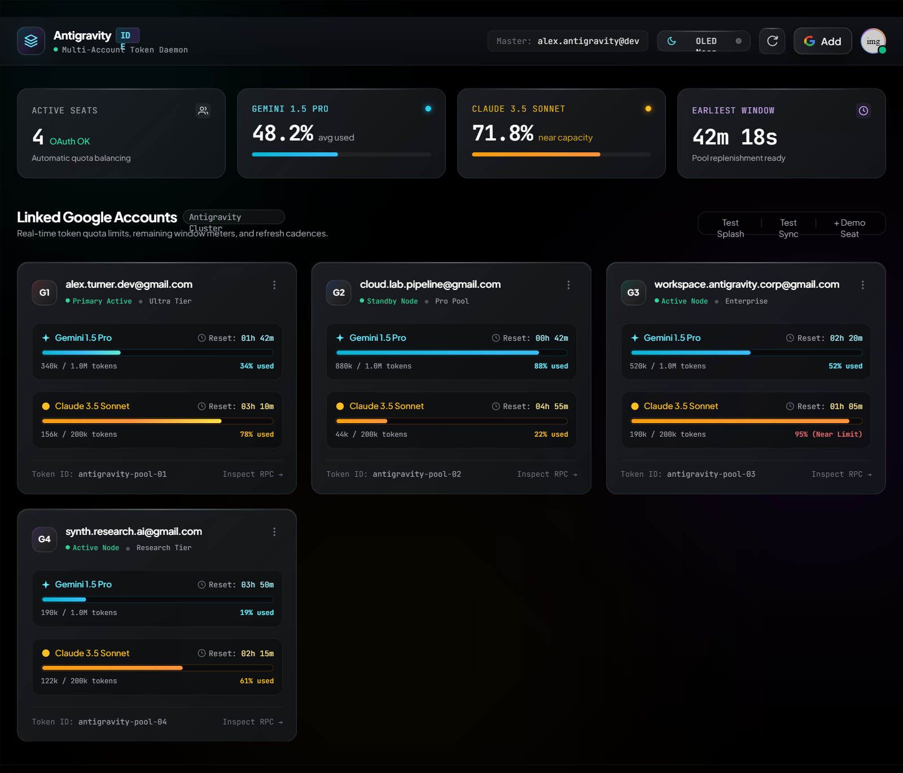
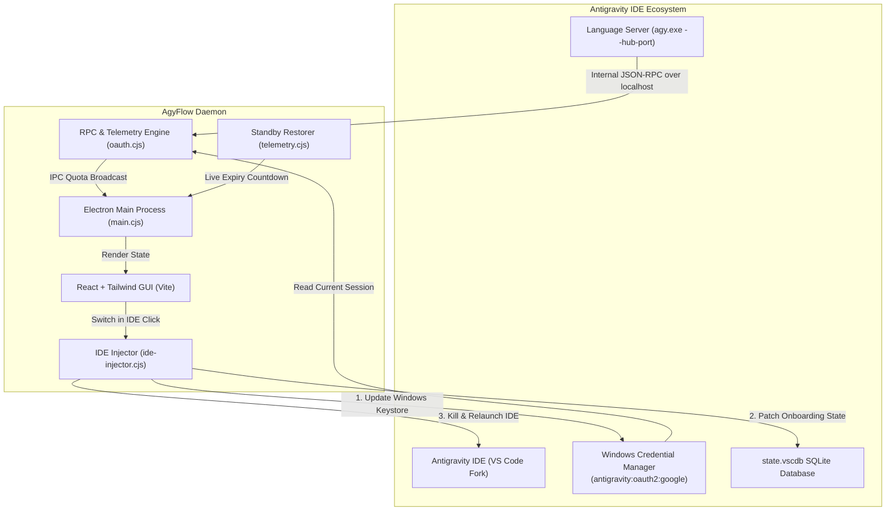

# 🌊 AgyFlow

<p align="center">
  <strong>Multi-Account Token Fleet Daemon & 1-Click Switcher for Google Antigravity IDE</strong>
</p>

<p align="center">
  
  
  
  
  
  
</p>

<p align="center">
  
</p>

---

## 📖 Overview

**AgyFlow** is a high-performance desktop companion daemon specifically engineered for power users of the **Google Antigravity IDE**. When developing AI-intensive applications, developers frequently exhaust their weekly quota pools for **Gemini Models** and **Claude + GPT Models**.

Instead of manually signing out, opening a browser, re-authenticating, and disrupting your IDE workspace, **AgyFlow** gives you:
- **Zero-Browser Quota Inspection**: Live telemetry directly queries the running Antigravity Language Server RPC socket.
- **1-Click IDE Account Switcher**: Injects credentials into Windows Credential Manager, updates IDE state databases, and restarts Antigravity seamlessly.
- **7-Day Rolling Reset Tracker**: Automatically tracks when standby accounts recover their 100% token quota and refreshes their state in real-time.
- **Dynamic Fleet Sorting**: Instantly ranks your Google accounts from highest available token balance to lowest (`Max → Min`).
- **4 Beautiful Themes**: Featuring a modern SaaS light mode (electric violet & pure white), dark obsidian, OLED pitch black, and warm latte.

---

## ✨ Key Features

| Feature | Description |
|---|---|
| ⚡ **Live Language Server RPC Telemetry** | Queries Antigravity's internal language server process (`agy.exe --hub-port` + CSRF tokens via WMI) for 100% exact live quotas without browser scrapers. |
| 🔄 **1-Click Seamless Account Injection** | Switches accounts in Antigravity IDE by patching Windows Keystore credentials (`antigravity:oauth2:google`), updating `state.vscdb`, and cleanly cycling the IDE process. |
| ⏳ **7-Day Rolling Standby Auto-Restoration** | Antigravity resets quotas on a rolling 7-day schedule. AgyFlow monitors every standby account's reset timestamp and auto-restores its balance to 100% once expired. |
| 📊 **Dual Quota Pool Visualization** | Displays two distinct meters per account: **Gemini Models** (cyan/emerald) and **Claude & GPT Models** (amber/gold) with live countdown timers. |
| 🏆 **Dynamic Fleet Ranking** | Standby accounts are automatically sorted by combined token availability (`Total Quota %`), allowing you to pick the best account immediately. |
| 🎨 **4 Curated Themes** | **Violet Light** (modern SaaS aesthetic matching Dribbble/Figma dashboards), **Dark Obsidian** (deep navy), **OLED Pure Black** (true `#000000`), and **Warm Latte** (creamy amber). |
| 📱 **Responsive & Mobile Sizing** | Scales effortlessly down to compact phone-sized widths (360px minimum width support) for docking alongside your code editor. |
| 🛡️ **100% Local & Privacy-First** | Tokens and credentials never leave your machine. Stored strictly in Windows Credential Manager and local disk files. |

---

## 🏗️ Architecture & How It Works



### 1. Language Server RPC Telemetry
AgyFlow automatically discovers the running `agy.exe` language server process via Windows WMI queries, resolves its dynamic hub port and authentication token, and sends direct internal RPC requests (`GetQuotaInfo`) to fetch exact token counts and reset timestamps.

### 2. Credential Injection & IDE Cycling
When you click **Switch in IDE**:
1. AgyFlow encrypts and writes the target account's OAuth credentials into the Windows Credential Manager under the target Antigravity target name.
2. It patches the SQLite database (`%APPDATA%\Antigravity\User\globalStorage\state.vscdb`) to update onboarding and user session keys.
3. It terminates the stale Antigravity process and relaunches it with the new active profile ready to code.

### 3. Rolling 7-Day Standby Math
Google Antigravity accounts operate on a strict 7-day quota recharge cycle. When you use an account and switch away, AgyFlow stores its recorded `resetTime`. Every 15 seconds, AgyFlow compares current wall-clock time against each account's deadline:
$$\text{Time Remaining} = \max(0, \text{resetTime} - \text{Date.now()})$$
When the timer hits zero, AgyFlow automatically resets the quota balance to **100% left** and marks the account as fully recharged!

---

## 📁 Project Structure

```
AgyFlow/
├── data/
│   └── userData.example.js     # Template user database (auto-initialized on first run)
├── electron/
│   ├── cred_tool.cs            # Native Windows Credential Manager C# interop
│   ├── cred_tool.exe           # Compiled DPAPI keystore reader/writer binary
│   ├── ide-injector.cjs        # Account switching & IDE state injection engine
│   ├── main.cjs                # Electron window lifecycle & IPC coordinator
│   ├── oauth.cjs               # Language Server RPC client & local telemetry
│   ├── preload.cjs             # Context isolation bridge for renderer
│   ├── read_cred.ps1           # PowerShell fallback keystore reader
│   ├── telemetry.cjs           # Fleet persistence & 7-day quota restoration math
│   ├── test_suite.cjs          # Automated E2E test verification suite
│   └── vault-reader.cjs        # Antigravity SQLite vault & avatar resolver
├── public/
│   ├── favicon.svg             # Application vector icon
│   └── loader-dark.webp        # Global animated cyan infinity loader
├── scripts/
│   └── launch-detached.cjs     # Background daemon launcher script
├── src/
│   ├── assets/
│   │   └── loader-dark.webp    # Bundled animated glowing loader
│   ├── components/
│   │   ├── AccountCard.jsx     # Active hero & standby quota card presentations
│   │   ├── AccountGrid.jsx     # Fleet grid layout & live quota rank sorting
│   │   ├── AddAccountModal.jsx # Account linking & active session importer
│   │   ├── ChromeAuthOverlay.jsx # Browser login instructions & flow assist
│   │   ├── ErrorBoundary.jsx   # UI fault recovery & restart fallback
│   │   ├── FleetBanner.jsx     # Dynamic fleet capacity summary & stats
│   │   ├── Header.jsx          # App branding, theme switcher & refresh actions
│   │   ├── RealGoogleAuthModal.jsx # Direct Google OAuth credential linker
│   │   ├── RpcModal.jsx        # Raw Language Server telemetry inspector
│   │   ├── SplashLoader.jsx    # Smooth launch screen with infinity animation
│   │   ├── StatusBar.jsx       # Real-time daemon connection status bar
│   │   ├── SyncOverlay.jsx     # Glassmorphic modal loading indicator
│   │   └── Toast.jsx           # Real-time notification toasts
│   ├── hooks/
│   │   └── useAccounts.js      # Central state hook with live countdown loop
│   ├── App.jsx                 # Root UI coordinator, modal manager & theme provider
│   ├── index.css               # Design system tokens, glassmorphism & typography
│   └── main.jsx                # React root bootstrap
├── index.html                  # HTML5 shell & fonts configuration
├── package.json                # Project dependencies and lifecycle scripts
├── postcss.config.cjs          # PostCSS processor configuration
├── run.bat                     # Windows 1-Click launcher
├── tailwind.config.js          # Tailwind CSS palette & styling tokens
└── vite.config.js              # Vite build & bundler configuration
```

---

## 🚀 Getting Started

### Prerequisites
- **Operating System**: Windows 10 or Windows 11 (64-bit)
- **Node.js**: v18.0.0 or higher ([Download Node.js](https://nodejs.org/))
- **Antigravity IDE**: Installed on the system ([Google Antigravity](https://antigravity.google/))

### Installation

1. **Clone the repository:**
   ```bash
   git clone https://github.com/your-username/AgyFlow.git
   cd AgyFlow
   ```

2. **Install project dependencies:**
   ```powershell
   npm install
   ```

3. **Build the frontend:**
   ```powershell
   npm run build
   ```

---

## 💻 Running the App

### Option 1: 1-Click Launch (Recommended for Daily Use)
Simply double-click the **`run.bat`** file in the project root:
```bat
run.bat
```
This builds the latest frontend and launches the application as an independent detached desktop daemon.

### Option 2: Command Line (Production Daemon)
```powershell
npm start
```

### Option 3: Development Mode (with Hot Module Replacement)
If you are modifying React components or styling:
```powershell
npm run dev
```

### Option 4: Attached Electron Window (for DevTools Debugging)
```powershell
npm run start:attached
```

---

## 🎨 Themes Guide

Click the **Theme Button** in the upper-right corner of the header to cycle through the 4 available modes:

```
[ 🌙 Dark Obsidian ]  ──▶  [ ☀️ OLED Black ]  ──▶  [ 🟣 Violet Light ]  ──▶  [ ☕ Warm Latte ]  ──▶  (Loop)
```

1. **Violet Light (Modern SaaS Dashboard)**:
   - Soft lavender-gray canvas (`#F4F5FB`)
   - Pure crisp white cards (`#FFFFFF`) with gentle elevated drop shadows
   - Signature **Electric Violet Gradient** on the Active Hero Card (`#6C47FF` → `#4F28D9`)
   - Neon lime green and golden amber quota meters
   - Soft pastel pill capsules (`#F0EBFE`, `#E8F9F1`, `#FEF3C7`)
2. **Dark Obsidian (Default)**:
   - Deep matte obsidian (`#090A0F`) with frosted glass panels (`rgba(18, 21, 30, 0.72)`)
   - Electric cyan accents and neon glow borders
3. **OLED Pure Black**:
   - True pitch black (`#000000`) for absolute contrast and zero battery drain on OLED screens
4. **Warm Latte**:
   - Cozy warm cream canvas (`#FDF9F3`) with amber and stone accents

---

## 🔧 How to Use

### 1. Linking Accounts
1. Open Antigravity IDE and log into your primary Google account.
2. Open **AgyFlow**. It will automatically detect your currently logged-in account, query the local language server, and pin it to the top as the **Active IDE Account**.
3. To add standby accounts:
   - Click the **`+ Add`** button in the header.
   - Or switch accounts inside Antigravity IDE and click **Import Current Active IDE Account**.
   - Your accounts will now appear in the **Linked Google Accounts** grid below.

### 2. Switching Accounts
1. In the **Linked Google Accounts** section, locate the account with the highest token availability.
2. Click **`Switch in IDE`**.
3. AgyFlow will:
   - Inject the account's credentials into Windows Credential Manager.
   - Patch Antigravity's local database.
   - Restart Antigravity IDE with the new account logged in.
4. The dashboard will automatically update to reflect the newly active account.

### 3. Inspecting Live RPC Specs
To view raw telemetry returned by Antigravity's internal language server:
- Click **`RPC Specs`** in the footer of any account card.
- A modal will open displaying raw quota objects, model identifiers, reset timestamps, and server communication latency.

---

## ❓ Troubleshooting & FAQ

<details>
<summary><strong>Q: The app shows 0% or cannot read tokens for the active account.</strong></summary>

**Solution:** Ensure Antigravity IDE is currently running. AgyFlow communicates with the local language server process (`agy.exe`). If Antigravity is completely closed, the language server cannot answer queries. Launch Antigravity and click the **Refresh** icon in the header.
</details>

<details>
<summary><strong>Q: "Unable to read credential from keystore" message appears.</strong></summary>

**Solution:** Windows Credential Manager may be temporarily locked or running under a different user context. Ensure you are running AgyFlow under the same Windows user account as Antigravity IDE. You can test manual extraction by running:
```powershell
node electron/test_suite.cjs
```
</details>

<details>
<summary><strong>Q: PowerShell script execution error during RPC probe.</strong></summary>

**Solution:** If your system restricts unsigned PowerShell scripts, enable local script execution for the current user:
```powershell
Set-ExecutionPolicy -ExecutionPolicy RemoteSigned -Scope CurrentUser
```
</details>

<details>
<summary><strong>Q: Antigravity IDE does not restart after clicking "Switch in IDE".</strong></summary>

**Solution:** If Antigravity was installed in a non-standard directory, check that `code.exe` or `antigravity.exe` is in your system `%PATH%` or located in `%LOCALAPPDATA%\Programs\Antigravity`.
</details>

---

## 🔒 Security & Privacy

- **Zero Cloud Storage**: AgyFlow has no remote backend or telemetry server. All data stays strictly on your local machine.
- **Windows DPAPI Encryption**: Authentication tokens are read and written using Windows Credential Manager, leveraging native Windows Data Protection API (DPAPI) encryption.
- **Read-Only Inspection**: Language Server RPC requests are local `GET` queries that do not alter token state or trigger external requests.

---

## 🤝 Contributing

Contributions, issues, and feature requests are welcome!

1. Fork the repository
2. Create your feature branch (`git checkout -b feature/AmazingFeature`)
3. Commit your changes (`git commit -m 'feat: Add AmazingFeature'`)
4. Push to the branch (`git push origin feature/AmazingFeature`)
5. Open a Pull Request

---

## 📄 License

Distributed under the **MIT License**. See `LICENSE` for more information.

---

<p align="center">
  Built with ❤️ for the Google Antigravity developer community.
</p>
